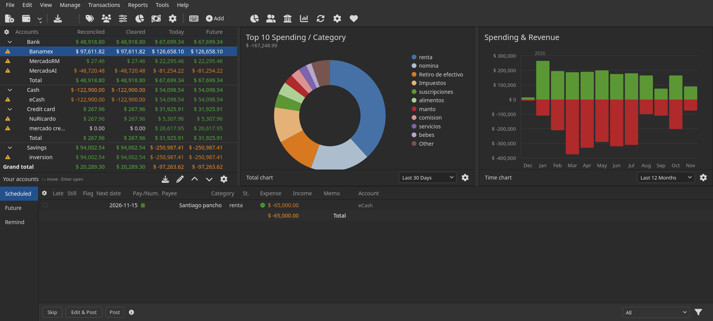
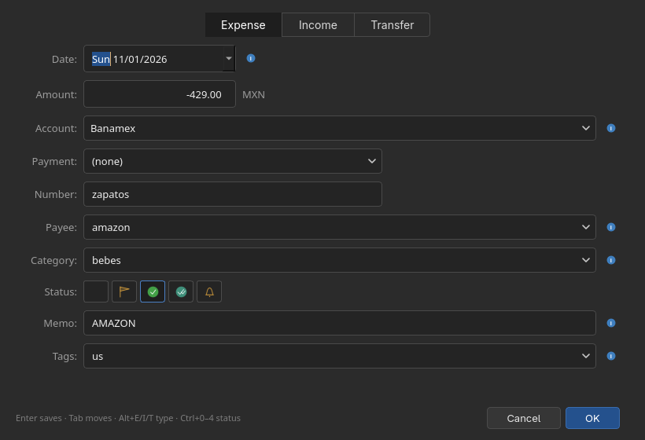
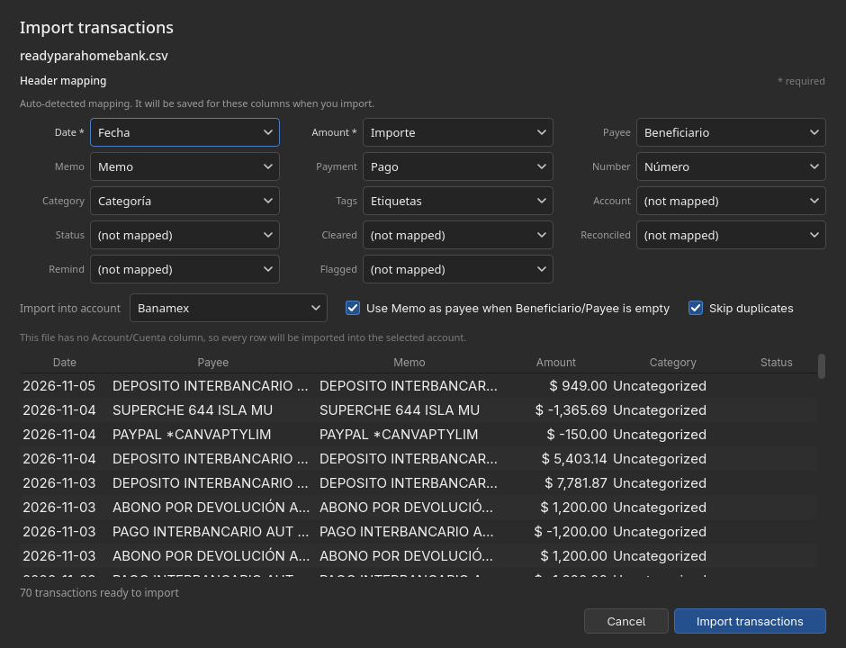
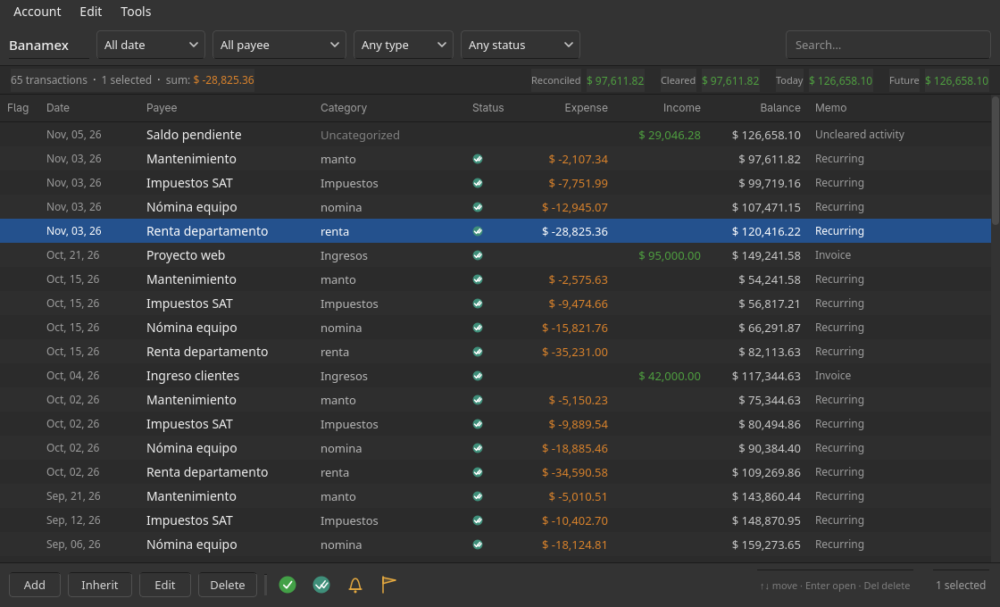
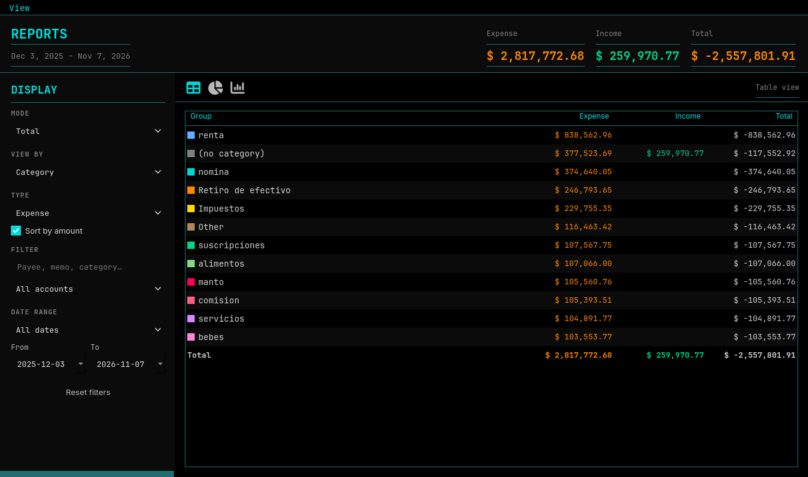

# ContaPy

A HomeBank-inspired, local-first personal finance dashboard built with **Python, PySide6 and SQLite**. The welcome screen, account ledger and transaction editor are from-scratch PySide6 interpretations of [HomeBank](https://www.gethomebank.org/) — fully interactive, not mockups.

This is totally vibe coding, using first DeepSeek-Harness and then (while on Omarchy) OpenCode. Im not quite sure what I'm doing honestly; I just love Homebank, but a few things I didn't like, so I kind of made this



*(Compact layout at 1500×870: [screenshots/welcome-compact.png](screenshots/welcome-compact.png))*

## HomeBank inspiration

The layout, terminology and dark chrome follow HomeBank: grouped accounts with **Reconciled / Cleared / Today / Future** columns, the total and time charts, the Scheduled / Future / Remind strip at the bottom, and a separate **account ledger** window with filters, running balances and status icons. Everything is implemented independently in Python/PySide6; this is not the HomeBank codebase and is not affiliated with the HomeBank project.

The account **Ledger**, the **Transaction editor** and the **Reports** window are implemented as separate windows, like HomeBank's own windows. The current build uses its own SQLite store; opening HomeBank `.xhb` files or importing QIF/OFX/QFX is not implemented yet.

## Transaction editor



The editor follows HomeBank's transaction dialog: **Expense / Income / Transfer** tabs, date and signed amount with currency code, account, payment mode, number, payee, category, status icons, memo and tags. Payee, category, payment and tags are editable with type-to-search completion.

Keyboard-first behaviour:

- **Enter** saves from any field (including an open completion popup).
- **Tab / Shift+Tab** moves through the form; info buttons are skipped.
- **Alt+E / Alt+I / Alt+T** switch Expense / Income / Transfer.
- **Ctrl+0…5** set None / Flag / Cleared / Reconciled / Remind / Void.
- **Escape** cancels.

Transfers create two linked transaction legs (one per account) and are deleted together.

## Importing bank CSVs



CSV import auto-detects HomeBank-style English and Spanish headers, ignores accents and punctuation, and previews the mapped rows before importing. Every field in the **Header mapping** grid is an editable dropdown — Date, Amount, Payee, Memo, Payment, Number, Category, Tags, Account, Status and the status flags. The supplied bank file maps like this:

| File column | ContaPy field |
|---|---|
| Fecha | Date |
| Importe | Amount |
| Beneficiario | Payee |
| Memo | Memo |
| Pago | Payment |
| Número | Number |
| Categoría | Category |
| Etiquetas | Tags |

Pick the target account in the dialog. When `Beneficiario` is blank, the **Use Memo as payee** option (on by default) makes the bank description searchable as the payee while keeping the memo. This exact file imports as 70 transactions totalling 35,038.47; a fixture test locks that behaviour in.

Mappings are remembered automatically. After an import, the current field mapping is saved under a signature of the file's headers (column order, case and accents are ignored). The next file with the same header set opens with **Saved mapping loaded for these columns** and the dropdowns already set. Changing any dropdown and importing updates the saved profile.

### Airbnb exports

**File → From Airbnb…** (also in the toolbar's account-actions menu and under **Tools**) converts an Airbnb reservation export and then opens the normal import preview. It drops `Payout` rows, converts `Fecha de inicio` to an ISO date, and builds the memo from the confirmation code, type, space and guest. The result matches the output of the original `airtransa.py` script.

### Booking payouts and Sabee reservations

**File → From Booking…** asks for two files: the Booking finance/payout CSV and the Sabee reservation CSV. It merges them on the Booking number / Sabee Channel ID, adds the Sabee room name to each memo, and unpivots the amount columns (`Amount`, `Commission`, `Payments Service Fee`, VAT and withholding, plus `Final amount`/`Commission amount`/`Payment fee` when present) into one row each. Dates come from `Checkout`/`Departure`; reservations without a matching Sabee room are labelled `Sin habitación`. The result matches the output of the original `tui_consolidator.py` script.

### Banamex statements

**File → From Banamex…** converts a saved Banamex HTML statement and opens the same import preview. It reads the statement's transactions table, converts `08 Nov` dates to ISO using the year from the statement header (rolling December into the previous year for January statements), and cleans up `Concepto de pago`/`Referencia` descriptions. The result matches the original `banahtml.py` script.

### Duplicate rows

The preview checks every valid row against the transactions already in the target account and marks matches with **Duplicate** in the Status column. The check uses the **memo as the primary field**, together with the date and amount to avoid flagging recurring payments that share a description. Memo matching ignores case, accents and punctuation. Rows with no memo fall back to payee + date + amount.

Every row has an **Import** checkbox. Rows that are not duplicates start checked; duplicates start unchecked, so importing the same statement twice only adds the new rows. Tick a duplicate to import it anyway, or untick any other row to leave it out. The Import button is disabled when no rows are selected. The check is per account and only compares against transactions already in the database; identical rows inside one CSV are not removed from each other. The import summary reports both unchecked duplicates and unreadable rows.

## Account ledger



Double-click an account (or press `Ctrl+L`) to open its ledger. It follows HomeBank's account window: date/payee/type/status filters, a search box, newest activity first with a running balance per row, status icons for cleared/reconciled/remind/flag/void, reconciled–cleared–today–future balances, and Add / Inherit / Edit / Delete actions. Select rows to mark them cleared or reconciled, or to toggle remind, flag and void. Select two or more rows and the ledger highlights the unselected transaction whose amount is closest to their total; press **Alt+V** to void the highlighted rows. Voided rows stay visible in the ledger but are excluded from balances, reports, charts, future/remind lists and unreconciled alerts. The date filter offers **All date**, **This month**, **Last month**, **This year**, **Last year** and **Custom range…**, which asks for an inclusive start and end date.

The ledger opens focused on the newest transaction:

- **↑ / ↓** move through transactions; **Home / End** jump to the newest/oldest.
- **Enter** opens the selected transaction in the editor.
- **Delete** deletes it (with confirmation).
- **Enter** in the search box jumps focus to the filtered results.
- **Tab / Shift+Tab** return to the filters when needed.

## Reports



**Reports → Reports Window…** (`Ctrl+R`) opens a live report over the current
database. The toolbar's **Spending report** button also opens this window. The
left **Display** panel controls the report:

- **Mode** — **Total** groups the whole date range; **Time** breaks it down by
  month.
- **View by** — Category, Payee or Account (hidden in Time mode).
- **Type** — Expense or Income. Uncategorised transactions appear in both
  reports, as they do in HomeBank.
- **Sort by amount** — largest first instead of the category order.
- **Filter** — free-text search over payee, memo, tags and category, plus an
  account filter.
- **Date range** — All dates, This month, Last month, This year, Last year or
  a custom From/To pair.

The header always shows the **Expense**, **Income** and **Total** for the
filtered rows. Switch between the three views from the toolbar or with
`Ctrl+1` / `Ctrl+2` / `Ctrl+3`:

- **Table** — one row per category/payee/account or month, with amounts and a
  totals row.
- **Pie chart** — donut with a legend showing the exact amount and share.
- **Bar chart** — horizontal amount bars in Total mode, or a monthly
  income/spending chart in Time mode.

Every change applies immediately, and open report windows refresh when the
ledger changes or `F5` is pressed.

## What the welcome page includes

- **Account tree** — Bank, Cash, Credit card and Savings groups with collapsible rows, alert markers for accounts with unreconciled transactions, and the four reference columns: **Reconciled, Cleared, Today, Future**. Group totals and the grand total update from the ledger. The list opens focused: **↑/↓** walk the accounts, **Home/End** jump, and **Enter** opens the selected account's ledger.
- **Spending donut** — top ten expense categories plus *Other*, drawn with `QPainter`. Switch the footer to **Income** for the top ten income categories, and change periods from the same footer. Hover a slice for the category, amount and share.
- **Spending & Revenue bars** — twelve months of income above zero and spending below, with the exact plotting style of the reference (green up, red down, 100k grid, year tag). Hover a month for income, spending and net.
- **Scheduled strip** — Scheduled lists upcoming bills; Future and Remind are filtered views of the ledger (posted future-dated transactions and reminder-flagged transactions), just like HomeBank. Scheduled rows have working **Skip**, **Edit & Post** and **Post** actions; ledger rows open the account ledger.
- **Reference chrome** — the File/Edit/View/Manage/Transactions/Reports/Tools/Help menu, icon shortcut toolbar, account footer tools, filter flyout, and the “Your accounts” status row.

The demo figures are aligned to the reference: last 30 days **$167,248.99**, reconciled **$20,289.30**, today/future **−$97,263.62**.

## Features beyond the screenshot

- **Account ledger** — a HomeBank-style transaction window per account, with date/payee/type/status filters (including a custom date range), a search box, running balance, reconciliation/remind/flag/void icons, account balance summary, and add/edit/inherit/delete actions.
- **Transaction editor** — Expense/Income/Transfer tabs, payment mode, number, tags, status icons, type-to-search combos, and Enter-to-save.
- **CSV import** — automatic English/Spanish header detection, editable field mapping, remembered header profiles, mapped-row preview with per-row import checkboxes, duplicate detection by memo, target-account selection and memo-to-payee fallback.
- **Airbnb import** — converts Airbnb reservation exports (dropping payout rows and rebuilding memos) before the standard import preview.
- **Booking import** — merges Booking payout and Sabee reservation exports, unpivots the amount columns and adds room names before the standard import preview.
- **Banamex import** — converts saved Banamex HTML statements (dates, memos and amounts) before the standard import preview.
- **Reports window** — HomeBank-style Display panel, Category/Payee/Account and monthly grouping, Expense/Income types, date presets and custom ranges, search and account filters, and table, pie and bar views.
- Schedule one-off bills; post or skip them from the home strip.
- Mark posted transactions as cleared, reconciled, remind, flagged or voided; these drive the home balance columns and Future/Remind lists. Voided transactions are kept for the audit trail but ignored by balances and reports.
- SQLite persistence (no server, no account, no telemetry).
- CSV import/export, chart PNG export, demo-data reset, keyboard shortcuts.
- Responsive chart legends and axis labels down to a 1400×760 window.

## Run it

Requires **Python 3.10+** and **PySide6 6.6+**.

```bash
cd contapy
python3 -m venv .venv
source .venv/bin/activate
pip install -r requirements.txt
./run.sh
```

On Arch, `sudo pacman -S pyside6` is usually enough (no venv needed).

```bash
python3 main.py                 # normal launch
python3 main.py --db my.db      # use a specific database
CONTAPY_DB=/tmp/demo.db python3 main.py
```

The first launch seeds a demo dataset. Data lives at `~/.local/share/contapy/contapy.db` (honouring `XDG_DATA_HOME`). Use **Preferences → Reset demo data** to return to the seeded state.

### Switching databases

**File → Open Database…** (`Ctrl+O`) opens another SQLite database without
restarting. ContaPy remembers the choice in `~/.config/contapy/config.json`
(honouring `XDG_CONFIG_HOME`) and reopens that database on the next launch. The
window title shows the database filename so it is always clear which file is
active.

Startup precedence is: `--db`, then `CONTAPY_DB` / `BUDGET_DB`, then the
database remembered from the File menu (only if the file still exists), then
the default location. `--db` and environment overrides are one-off and do not
change what is remembered. To go back to the default database, open it from
the same menu or delete `~/.config/contapy/config.json`.

**File → Save Database As…** (`Ctrl+Shift+S`) writes a consistent snapshot to a
new location and continues working from that copy, so later edits go to the
new file. The new path is remembered for the next launch, and the original
database is left untouched as a safety copy.

### Daily backups

ContaPy keeps one automatic copy per day in a folder named `dailylbaka` beside
the active database:

```
~/.local/share/contapy/dailylbaka/contapy-2026-11-06.db
```

The backup is created the first time ContaPy runs on a new day, checked again
hourly while the app stays open, and when the app closes. Existing daily files
are never overwritten, so the folder grows by one database per day. Backups are
ordinary SQLite files: to restore one, use **File → Open Database…** to open the
dated file, then **File → Save Database As…** to write it back over your normal
database. Backups follow the database: after **Save Database As…**, the new
location gets its own `dailylbaka` folder.

> **Upgrading from Budget:** if the old `~/.local/share/budget/budget.db` exists, the first ContaPy launch copies it to the new location automatically. The original file is left untouched. `CONTAPY_DB` overrides the path; the older `BUDGET_DB` variable is still honoured.

### Theme

ContaPy defaults to **One Dark**. Open **Preferences** (`Ctrl+,`) and use the
**Theme** selector to switch to any theme installed under
`~/.config/omarchy/themes`, `~/.local/share/omarchy/themes` or
`/usr/share/omarchy/themes`. The choice is remembered in
`~/.config/contapy/config.json` and the window is rebuilt immediately with the
new palette — panels, menus, inputs, selection, status colours and the category
donut all follow it. Both dark and light themes work.

The selector also offers **Omarchy current theme**, which follows
`~/.local/state/omarchy/current/theme/colors.toml` (honouring
`XDG_STATE_HOME`), and **Graphite (built-in)**, the original ContaPy palette.
If the selected theme disappears, ContaPy falls back to the graphite palette;
One Dark itself is bundled so the default works without Omarchy installed.

Environment variables override the saved choice:

```bash
CONTAPY_THEME=builtin python3 main.py                    # ignore the saved theme
CONTAPY_THEME=one-dark python3 main.py                   # force a theme slug
CONTAPY_THEME_FILE=/path/to/colors.toml python3 main.py  # force a palette
```

### Date format and ledger status

**Preferences** also controls how dates are displayed and which transactions the
ledger shows by default.

- **Date format** offers eight styles and defaults to `yyyy/mmm/dd`, rendered
  like `2026/feb/14`. The choice applies immediately to the dashboard, ledgers,
  scheduled dates, reports, import previews and date pickers. Dates remain
  stored and compared as ISO strings, so the setting only changes presentation.
- **Ledger status** chooses the filter applied whenever an account ledger opens:
  **Any status**, **Unreconciled**, **Cleared**, **Reconciled**, **Remind**,
  **Flagged** or **Voided**. The default is **Any status**.

Both choices are remembered in `~/.config/contapy/config.json` alongside the
theme.

Toolbar and status icons come from the bundled Font Awesome Free 6.6 Solid web
font, with the original painted shapes as fallbacks. The font is licensed under
the SIL OFL 1.1; see `contapy/assets/FONT-AWESOME-LICENSE.txt`.

### Screenshot mode

The welcome image above was rendered without a compositor:

```bash
python3 main.py --screenshot screenshots/welcome.png --size 1850x835
```

## Using it

| Action | How |
|---|---|
| New transaction | `Ctrl+N`, the **Add** button, or the toolbar page icon |
| Save the transaction window | `Enter` from any field |
| New account | `Ctrl+Shift+N` or **Manage → New Account…** |
| Open the account ledger | Double-click an account, press `Ctrl+L`, or right-click → **Open ledger** |
| Navigate accounts | `↑` / `↓`; **Home/End** for first/last |
| Open an account's ledger | `Enter` on the selected account |
| Edit an account | The pencil in the sidebar footer, or right-click → **Edit account…** |
| New scheduled bill | **Transactions → New Scheduled Transaction…** |
| Post / skip a bill | Select it in the Scheduled tab, then use the bottom buttons |
| Edit a ledger row | Select it in the strip and click **Open Ledger**, or double-click it |
| Reconcile / remind / flag / void | Select rows in the ledger, then use the icons in the bottom bar |
| Void the closest highlighted rows | `Alt+V` with two or more ledger rows selected |
| Navigate ledger rows | `↑` / `↓`; **Home/End** for newest/oldest |
| Open a ledger transaction | `Enter` on the selected row |
| Delete a ledger transaction | `Delete` on the selected row |
| Close the account ledger | `Escape` (or `Ctrl+W`) |
| Filter the strip | The **All** account combo and the filter icon |
| Change chart period | The combo in each chart footer |
| Import / export | `Ctrl+I` / `Ctrl+E`; the import dialog auto-detects HomeBank/Spanish headers |
| Open another database | **File → Open Database…** or `Ctrl+O` |
| Save a copy elsewhere | **File → Save Database As…** or `Ctrl+Shift+S` |
| Refresh | `F5` |
| Preferences | `Ctrl+,` |

In the account list: **↑/↓** move, **Home/End** jump, **Enter** opens the ledger. In the ledger: **↑/↓** move, **Home/End** jump, **Enter** opens the selected transaction, **Delete** removes it, and **Escape** closes the ledger. In the transaction window: **Enter** saves, **Tab** moves, **Alt+E/I/T** switches type and **Ctrl+0–5** sets status. **Escape** cancels. The home strip also supports **↑/↓** and **Enter** (edit scheduled / open future or remind rows). **Ctrl+R** opens the report window, where **Ctrl+1/2/3** switch table, pie and bar views and **F5** refreshes. Keyboard shortcuts are also available under **Help → Keyboard Shortcuts**.

### CSV format

```csv
date,account,payee,category,memo,amount,cleared,reconciled,remind,flagged,voided,payment,number,tags
2026-11-06,eCash,Coffee,alimentos,Morning coffee,-85.50,yes,no,no,no,Cash,,
2026-11-07,Banamex,Client payment,Ingresos,Invoice 104,12000.00,yes,yes,no,no,,1042,work
```

`date` and `amount` are required; missing accounts/categories are created during import. Dates may be `YYYY-MM-DD`, `MM/DD/YYYY` or `DD/MM/YYYY`. Status, payment, number and tags columns are optional for older CSVs. Imports also accept HomeBank-style headers (`Fecha`, `Importe`, `Beneficiario`, `Memo`, `Pago`, `Número`, `Categoría`, `Etiquetas`), and a file without an Account column is imported into the account selected in the import dialog. Header mappings can be edited in the dialog and are remembered per header set.

## How it works

```
main.py                     launcher
contapy/
  app.py                    QApplication, icon, screenshot mode
  config.py                 remembers the last database outside the DB
  dates.py                  selectable date display formats
  main_window.py            chrome, menus, actions, refresh
  db.py                     SQLite schema, balances, reports, CSV
  seed.py                   deterministic reference-shaped demo data
  omarchy.py                reads Omarchy colors.toml, derives semantic tokens
  theme.py                  Qt tokens, stylesheet, palette, font selection
  fontawesome.py            bundled Font Awesome glyph loading and rendering
  models.py                 small dataclasses
  widgets/
    accounts.py             custom-painted account tree and footer
    charts.py               donut, bars, card chrome
    scheduled.py            tabs, table and action bar
    ledger.py               HomeBank-style account ledger window
    dialogs.py              transaction/account/preferences dialogs
    toolbar.py              Font Awesome shortcut toolbar
    icons.py                themed glyph icons with painted fallbacks
    reports.py              report window, table/pie/bar views
tests/test_store.py         headless ledger tests
tests/test_omarchy.py       palette parsing, dark/light tokens and fallbacks
```

- **All charts are custom-painted** with `QPainter`; there is no matplotlib or QtCharts dependency.
- **Balances are derived from posted transactions**, never stored as display-only snapshots. *Reconciled* and *Cleared* use the transaction statuses; *Future* adds already-posted future-dated transactions. Voided transactions are kept in the ledger but never contribute to balances or reports. Unposted schedule rows live in the scheduled strip until you post them.
- **Alert triangles are derived too**: an account shows one while it has posted, past-dated transactions that are not reconciled. Reconcile them in the ledger (or clear future entries when they arrive) to make the marker disappear.
- **Charts are portfolio-wide**; selecting an account highlights it for editing / opening its ledger without filtering the reports, matching the reference’s state.
- The demo data uses a deterministic generator relative to “today”; a fresh seed lands on the reference totals, including the $167,248.99 rolling donut.

## Tests

```bash
python3 -m unittest discover -s tests -v
```

Seventy-nine tests cover the reference balances, the rolling donut total and income breakdown, selectable date formats and their default, the saved ledger status filter, closest-amount highlighting for voiding, posting schedules, running ledger balances, reconciled/cleared transitions, voided transactions, unreconciled-account alerts, the 70-row HomeBank bank-CSV import, custom and remembered header mappings, CSV round-trips, duplicate detection, report aggregation, remind flags, demo reset, the Booking/Sabee consolidation, and Omarchy palette parsing, theme discovery and fallbacks (dark, light, contrast).

## Notes / limitations

- One currency; amounts display with `$`, and the transaction editor labels the configured code (`MXN` by default). No bank syncing.
- Schedules are one-off; there is no recurrence engine yet.
- Splits, payee matching and HomeBank's Budget/Statistics report windows are not implemented yet.
- Internal transfers are stored as two linked legs; CSV export writes those legs separately, and re-importing does not relink them.
- The UI is English while the seeded demo data is Spanish, mirroring the reference.
- Written and tested on Linux/Wayland with Python 3.14, PySide6 6.12 and Qt 6.12; it should run anywhere PySide6 does.
- HomeBank's own file format (`.xhb`) and QIF/OFX/QFX imports are not supported yet; data lives in SQLite.
